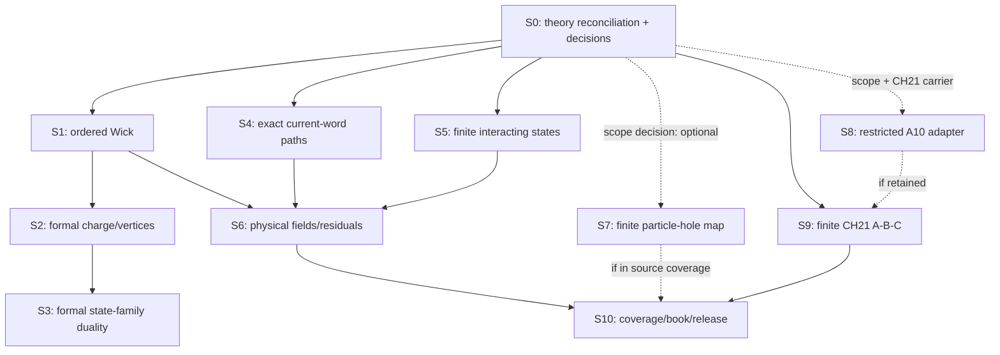

# V1 completion contract and dependency graph

> **Current status — 2026-10-25:** S1–S6 are locally accepted in their exact
> scopes. S6 completed the reviewed physical-field obstruction/residual package.
> The [remaining strategy](../V1_REMAINING_STRATEGY_2026-10-25.md) supersedes
> old readiness/next-action wording below. S7/S8 selection and comprehensive
> source coverage remain open; historical proposals are not acceptance receipts.

Date: 2026-10-17. Status: proposed; not accepted. This contract preserves the
existing source-coverage objective in
[`BOOK_AND_SOURCE_COVERAGE_PLAN.md`](../../BOOK_AND_SOURCE_COVERAGE_PLAN.md).
An obstruction resolves only the precise proposed equality it disproves; it is
not counted as proof of that equality.

## Classification of obligations

| Obligation | Classification | Reason and V1 consequence |
|---|---|---|
| Complete ordered Wick recurrence on A08's uncompressed state | Required construction/proof for proposed V1 Chapter 20 scope | The current A08 functional has the needed ordered vacuum rules and contextual CCR; it is a finite algebraic extension of accepted support, not a finite CAR claim. |
| Formal charge/oscillator coefficient identities with fixed Klein gauge and order | Required construction/proof for proposed V1 Chapter 20 scope | Section 20.2 makes these formulas part of the Chapter 20 mathematical narrative. Keep `t` formal and normal-order prescriptions separate. |
| Formal parameter/charge-family duality | Required construction/proof if Section 20.3's algebraic duality remains in canonical V1 text | The oscillator and charge maps must form one gauge-explicit star map and transport the indexed family, not assert fixed-state invariance. |
| Unconditional equality of physical fields with the exact CH14 polynomial candidate | Research question resolved by proved obstruction and corrected claim | The full ground image counterexample and residual witness refute the inference from margins/one coefficient. Preserve CH14 as a conditional theorem; replace unconditional language with the exact conditional or a controlled finite comparison. |
| Exact selected finite current-word comparisons in a free finite sea | Required construction/proof for the proposed bridge, with exact paths | This gives a genuine finite-CAR link to the oscillator functional only for the inverse-Bogoliubov observable dictionary and verified suffix margins. It says nothing about an interacting ground state. |
| Existence of an interacting ground state on a specified finite budget | Required construction/proof if V1 claims a finite interacting state | Use the lowest spectral projection of the compressed Hermitian Hamiltonian. State explicitly that this is not automatically an ambient ground state. |
| All-moment equality between a finite interacting ground state and `omegaP` | Research question resolved by proved obstruction and corrected claim | The high-degree budget obstruction is conditional on monotone lowering-path hypotheses; the `h=8` witness falsifies the natural quadratic identification for one specified model. Neither proves a universal alternative bound. |
| Finite CAR norm/state comparison for physical fields | Required construction/proof for V1 physical scope, or a reviewed obstruction with explicit residuals | Keep the physical operators fixed; define common carriers and separate operator, residual, omitted-range and state errors. Unknown triangle terms do not count as quantitative control. |
| Distinct finite left particle-hole construction | Optional V1 extension requiring a substantive scope decision | Benefit: exact charge/budget and some Hamiltonian/order-parameter covariance. Dependencies: band reflection, parity strings, twists, zero-mode and Hamiltonian checks. Exclusion means no finite unitary duality claim; preserve the coverage row and label it explicitly deferred/obstructed rather than covered. **Default: optional, not a prerequisite of finite CH21.** |
| Genuine A10 shell-reduction application in CH21 | Optional V1 extension requiring a substantive scope decision; current coverage favors inclusion | Benefit: demonstrates the accepted finite second-order theorem on the actual CH21 shell/charge carrier. Needs restricted-carrier adapter, shifted charge sectors, nonresonance and exterior-buffer residuals. Exclusion means CH21 makes no effective-shell-reduction claim and the A10 source row remains an explicit coverage gap. **Default: include a narrow application because the current comprehensive source-coverage plan names A10 context.** User decision required to exclude it. |
| Stronger physical field reconstruction than CH14's conditional criterion | Optional as *exact equality*; a finite controlled comparison or reviewed obstruction is required by the current V1 source-coverage objective | Exact equality may be false. Benefit of a controlled result: link actual fields and candidate on a useful domain with quantified residuals. Exclusion leaves the Chapter 20 physical dictionary row open; it cannot be silently marked covered. **Default: do not require global exact equality; require a reviewed finite comparison/obstruction and preserve unresolved coverage.** |
| Analytic vertex evaluation, continuum power laws, thermodynamic gap, CFT/KT/RG and full-QED3 conclusions | V2 or later research backlog | Require completion/limits, regulator-family estimates or distinct models; no current finite proof supports them. |
| Full local-state/entanglement, quench/dynamics, refermionization/impurity, general reusable RG engine, coupled wires | V2 or separately scoped research backlog | These are not necessary for the finite Chapter 20/21 theorem packages. Preserve source coverage where applicable; do not present them as established by an Abelian finite chapter. |

## Recommended default and decisions for the user

Recommended baseline:

1. Finish the mathematical Chapter 20 bridge with the ordered Wick theorem,
   convention-fixed formal correlators/state-family duality, exact path-restricted
   finite current moments, a separately defined finite interacting spectral
   state, and one reviewed physical field comparison or proved obstruction with
   explicit residuals.
2. Do not claim unconditional CH14 field equality or identify the finite
   interacting ground state with `omegaP`.
3. Keep a distinct finite particle-hole implementation optional. If the text
   claims it, prove its actual twist/budget/Hamiltonian action as a separate map.
4. Include a narrow A10 application in CH21 by default, but expose it as a scope
   choice because the current CH21 proposal itself does not yet require that
   theorem and A10's source carrier is not yet adapted.
5. Do not start V2/finiteQMB work before V1 acceptance.

User decisions still needed before S1 interface freeze: (a) retain or exclude the
distinct finite particle-hole construction; (b) retain the proposed narrow A10
CH21 shell application (recommended yes); (c) approve the minimum physical
comparison/obstruction closure for Chapter 20 while explicitly excluding a
global field equality claim. These are mathematical/scope decisions, not
editorial details.

## Dependency graph

## S1–S10 readiness

“Ready for independent specification review” means a concrete target and
evidence packet can now be reviewed; it does not mean accepted or ready to code.

| Sprint | State after S0 documentation | Exact condition to move forward |
|---|---|---|
| S1 Ordered Wick | **Ready for independent specification review.** | Reviewer checks the pull-through derivation against the actual A08 contextual CCR/vacuum declarations, including order-sensitive contractions; then settle the S0 gate before any interface work. |
| S2 Formal vertices | **Waiting on S1 and convention review.** | Accept Wick target; fix CH13/manuscript Klein gauge, source phase order, Weyl/bare-normal/dressed-normal definitions and formal `t`; audit every coefficient/adjoint. |
| S3 Formal duality | **Ready for independent specification review after gauge is pinned; currently waiting on S0 decision.** | Reviewer derives the full ordered map and indexed-state transport for the chosen canonical gauge. Never combine with finite particle-hole map by name alone. |
| S4 Finite current-word bridge | **Waiting on named mathematics: exact suffix/path margin theorem.** | Derive right-to-left nonzero path bounds from `rho_budget_map`, Haldane completeness and charge/mode changes; prove any coarse `2dM+|N|≤h` wrapper rather than assume it. |
| S5 Finite interacting states | **Waiting on named mathematics: audited small Hamiltonian and precise high-moment domain.** | Independent derivation of the eight-state block and eigenvector; path-by-path proof of the monotone annihilation obstruction, with compression placement explicit. |
| S6 Physical fields | **Ready for independent specification review of the corrected target; depends on S0 scope decision.** | Reviewer verifies full-image counterexample, actual CH14 order/sign/twists, and either a restricted equality or explicit residual comparison. No global equality inference from margins. |
| S7 Finite particle-hole | **Conditional on user scope decision.** | If retained: independent finite CAR construction review, including `k→1-k`, parity, twists, excitation transport, Hamiltonian constants and distinction from formal right sign flip. |
| S8 A10 application | **Conditional on user scope decision and named CH21 carrier.** | Select finite direct-sum/restricted carrier; define low/shell projectors summing to its identity; handle shifted charge sectors and prove/retain exterior-buffer residuals, nonresonance and denominators. |
| S9 Finite CH21 | **Waiting on accepted Phase-A specification; S8 conditional.** | One reconciled interface, independent review, nonzero spatial-sum leakage coefficient derivation, then separate A–B–C evidence. No plausible reply formula alone passes. |
| S10 Closure | **Not ready.** | Close R6–R9, preserve every source-coverage row, audit exact accepted interfaces/proofs, book and release evidence. |

## A10 adapter requirement

In `A10DiscreteSchriefferWolff.lean`, `lowShellProj + highShellProj` equals the
ambient budget projection, not the ambient identity. `sw_compressed_bch_second_order`
is a theorem about `A05.Operators` and explicitly assumes complementary
idempotents with `P+Q=1` on that carrier. The minimal application path is either:

1. restrict to the actual finite budget subtype and prove the induced low/shell
   endomorphisms are complementary there, then transfer `H0,V,S1` and every
   hypothesis; or
2. add a separately reviewed theorem with budget projector `Π=P+Q` and retain
   every exterior term from `1-Π` in the compressed BCH identity.

CH21 Umklapp changes four species charges, so one fixed charge sector generally
is not an invariant carrier. Use a finite direct sum of all reachable shifted
charge sectors (or a typed source/target block formulation). Virtual paths that
leave this direct sum require an explicit outer-buffer residual. Check each
energy denominator/nonresonance condition on the actual source and target states.
The ambient equality `P_low+P_shell=Π_budget` alone cannot be substituted for
`P+Q=1` in the current theorem.

## Findings and next actions

- Confirmed: the current A10 theorem is a finite polynomial BCH identity, not an
  analytic exponential or RG remainder estimate.
- Confirmed: its present projectors do not already satisfy the theorem's
  complementary-on-carrier premise in ambient `A05.Operators`.
- Unresolved: whether the V1 CH21 scope includes that application.
- Next action: user selects the three scope items above; independent reviewer
  reviews this package; then S0 can be marked theory-accepted. Until then S1 is
  only ready for specification review and must not begin.
